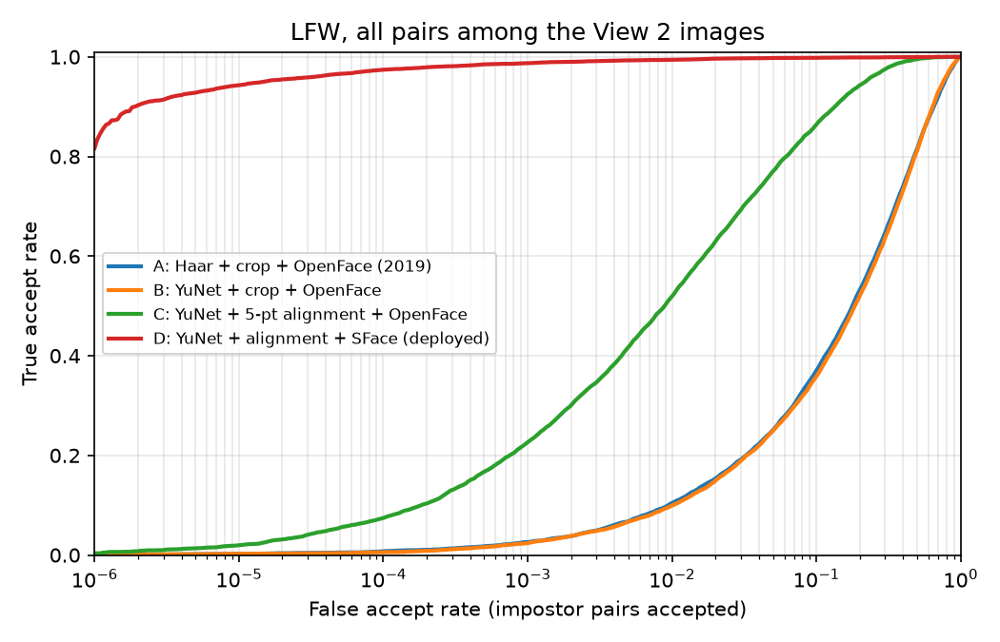
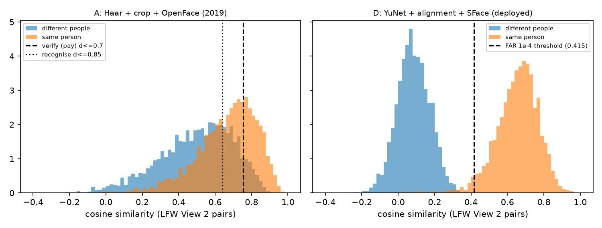
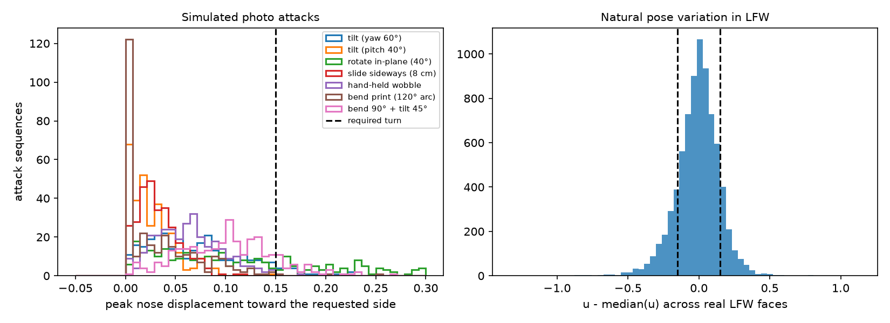
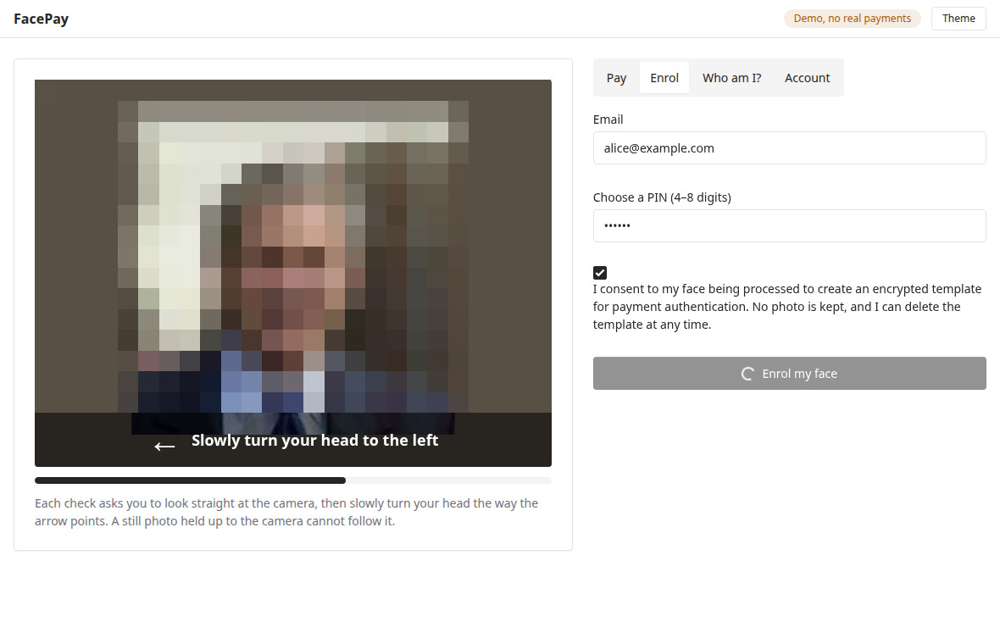

# FacePay: face verification with challenge-response liveness for payment authentication

*A 2026 revision of the MSc project "Facial Recognition System for Payments" (2019)*

Pranav Thombare · October 2026

## Abstract

The 2019 version of this project was a desktop application that compared a webcam photo against
a stored face embedding before "approving a payment". It worked on the happy path but was never
evaluated. This revision measures it, rebuilds it, and asks three questions. **RQ1:** how much
do face detection, alignment and the embedding model each contribute to verification accuracy at
the false-accept rates payments need? **RQ2:** what did the 2019 thresholds actually do, and which
thresholds are justified? **RQ3:** can a server-verified head-turn challenge, built only on five
facial landmarks, reject photo and screen presentation attacks, and what does it not stop?

On Labeled Faces in the Wild (LFW), the 2019 pipeline as built reaches 66.6 % verification
accuracy, and its payment threshold accepts 7.8 % of impostor pairs while rejecting 67.5 % of
genuine ones. Changing only the detector changes nothing; adding five-point alignment lifts the
same 2016 network to 88.6 %, but even then it accepts only 7.5 % of genuine pairs at a
false-accept rate (FAR) of 10⁻⁴. The embedding model dominates: the deployed YuNet + SFace
pipeline reaches 99.35 ± 0.37 % and accepts 97.4 % (95 % CI 97.0–97.7 %) of genuine pairs at
FAR 10⁻⁴, the operating point the service now uses. For liveness, the nose tip's affine
coordinates relative to the eyes and mouth do not change when a flat picture is moved, but shift
when a real head turns. Simulation showed that the landmark detector, not the geometry, limits
this cue. YuNet reports about a tenth of a photo's true in-plane rotation, and its errors let
5.5 % of best-case print and screen attacks through. With rotation measured from pixels instead
and a guard against strong foreshortening, 2 of 2,100 simulated print and screen attack
sequences passed (0.1 %), and no photo swap or face swap did. A smooth replay of the victim
turning passed 83 % of the time, which identifies video replay as the residual risk. Bona fide
error rates need a live study, whose protocol is given. The rebuilt service (FastAPI, oat.ink
UI) combines face, liveness and PIN, encrypts templates, stores no images, and is covered by 66
automated tests and a browser end-to-end test.

## 1. Introduction

### 1.1 Motivation

Face recognition is now an everyday payment authenticator, from "smile to pay" terminals to
phone unlocks that authorise card payments. In the EU and UK, the regulatory technical standards
for strong customer authentication under PSD2 count a biometric as an *inherence* factor and
require that the devices and software reading it have "a very low probability of an
unauthorised party being authenticated as the payer" [26, Art. 8]. That turns two engineering
questions into requirements: *how often does the matcher accept the wrong person* at the chosen
threshold, and *can a photo, screen or video of the account holder be presented instead of the
person*. The 2019 prototype answered neither.

### 1.2 The 2019 prototype

The original system (preserved in `legacy/`) was a Tkinter application. It captured a webcam
frame, found a face with OpenCV's Haar cascade [1], cropped and resized it to 96×96 pixels, and
embedded it with the OpenFace `nn4.small2` network [7], a compact FaceNet-style [6] model
trained with triplet loss. A user was "verified" if the Euclidean distance between the probe
embedding and the one stored for their email was at most 0.7; "recognition" picked the nearest
stored embedding if it was within 0.85. Embeddings were kept in a pickle file and enrolment
photos in a folder. Section 3 re-examines it.

### 1.3 Research questions

- **RQ1 (accuracy).** Holding the evaluation fixed, how much of the gap between the 2019 pipeline
  and a current one is due to the detector, to face alignment, and to the embedding model,
  especially at low false-accept rates?
- **RQ2 (thresholds).** What false-accept and false-reject rates did the fixed 2019 thresholds
  produce, and what thresholds does a payment use case justify?
- **RQ3 (liveness).** Can a randomised head-turn challenge, verified on the server from five
  landmarks per frame, reject flat presentation attacks (prints and screens, moved or bent), and
  which attacks remain?

### 1.4 Contributions

1. A reproducible audit of the 2019 system, including defects found by driving the application
   end to end (section 3).
2. A controlled ablation on LFW from the 2019 pipeline to the deployed one, with low-FAR
   operating points estimated from 29.6 million impostor pairs (sections 4.1–4.2, 6.1–6.2).
3. A liveness cue with a simple invariance argument: the nose tip's affine coordinates in the
   eye–mouth frame cannot be changed by moving a flat picture. The cue is embedded in a
   challenge-response protocol and tested against simulated print, screen, bending, multi-photo
   and replay attacks (sections 4.3–4.4, 6.3). The evaluation found that the landmark detector
   under-reports rotation about tenfold, and a pixel-based measurement fixes that.
4. A rebuilt service that combines face, liveness and a PIN, with a documented threat model
   (section 5).

### 1.5 Provenance and scope

The 2019 machine-learning code was largely reused from the deeplearning.ai Coursera assignment
"Face Recognition for the Happy House", itself built on Keras-OpenFace and the OpenFace weights
[7]. That provenance is now stated in `legacy/README.md`. The 2026 revision reuses pretrained
models (YuNet [4] and SFace [12] from the OpenCV Zoo) and trains nothing. Its contributions are
the evaluation, the liveness method and its analysis, and the system design. The revision (code,
experiments and this report) was carried out with the help of an AI coding assistant. Every
number reported here comes from the scripts in `research/`, which regenerate it.

## 2. Background and related work

### 2.1 Face detection and alignment

Viola and Jones' boosted Haar cascades [1] made real-time frontal face detection practical and
remained common in 2019, although OpenCV had shipped a DNN face detector since 2017. Convolutional detectors replaced them: MTCNN [2] jointly
predicts boxes and five landmarks, RetinaFace [3] adds dense supervision, and YuNet [4] is a
sub-megabyte detector designed for CPU inference that also outputs five landmarks (eye centres,
nose tip, mouth corners). Recognition networks are trained on *aligned* crops, usually produced
by a similarity transform that maps detected landmarks onto a fixed template. OpenFace used dlib
landmarks and an outer-eyes-and-nose template [7]; ArcFace-family models use a five-point
112×112 template [11]. Feeding a network crops that do not match its training alignment is a
well-known source of error, and section 6.1 measures it.

### 2.2 Face representations

DeepFace [5] and FaceNet [6] established the modern approach: a deep network maps a face to an
embedding whose distances reflect identity. FaceNet trained it with a triplet loss, and OpenFace
[7] released a small FaceNet-style model (`nn4.small2`, 3.7 M parameters) trained on about
500k images. Later work replaced triplets with margin-based softmax losses on a hypersphere:
center loss [8], SphereFace [9], CosFace [10] and ArcFace [11]. These train more stably and
separate identities by larger angular margins. SFace [12] constrains the intra- and inter-class
objectives with sigmoid curves to resist noisy labels. Its OpenCV Zoo model produces a
128-dimensional embedding compared by cosine similarity.

### 2.3 Measuring verification

LFW [13] is the classic unconstrained benchmark: 13,233 web photos of 5,749 people, with
a 10-fold protocol of 6,000 pairs (*View 2*) and a separate development split (*View 1*) for
model selection. Accuracy on View 2 is now saturated near 99.8 % for strong models, and a
single accuracy number hides behaviour at low FAR, which is what an authentication system
operates at. The BLUFR protocol [14] therefore evaluated LFW over all pairs to report the true
accept rate (TAR) at FAR down to 10⁻⁴, and later benchmarks such as IJB-C [15] report TAR at
FAR 10⁻⁴ to 10⁻⁶. ISO/IEC 19795-1 [16] defines the vocabulary used here: false accept/reject
rates, failure to acquire (FTA), and operating points.

### 2.4 Presentation attacks and liveness

ISO/IEC 30107-3 [17] defines presentation attack detection (PAD) and its error rates: APCER
(attack presentations wrongly accepted as bona fide) and BPCER (bona fide presentations wrongly
rejected). Public databases capture printed-photo, screen-replay and mask attacks: Replay-Attack
[18], OULU-NPU [19] and SiW [20]. *Passive* PAD classifies a single frame or short clip, using
texture [18] or deep features with auxiliary depth and rPPG supervision [20]. *Active* PAD asks
the user to do something a static artefact cannot: blink [21, 22], smile or turn the head.
Active schemes are cheap and explainable, but by construction they do not stop a video of the
right action, and they cost the user time.

### 2.5 Regulation, privacy and fairness

Under GDPR, biometric data processed to identify a person is special-category data (Art. 9 [25]),
which needs explicit consent or another Art. 9(2) condition, a data-protection impact assessment
for high-risk processing (Art. 35), and data minimisation. PSD2's strong customer authentication
rules [26] pair an inherence factor with knowledge or possession. Face templates are not
harmless: images can be partly reconstructed from deep templates [27], so templates need
protecting at rest. Accuracy also varies across demographic groups. Gender Shades [23] exposed
this in commercial face analysis, and NIST's FRVT demographic study [24] measured
false-match-rate differentials across age, sex and race for most verification algorithms.

## 3. The 2019 prototype, re-examined

### 3.1 Reproducing it in 2026

The repository could not be installed from its own instructions. Dependabot had raised
TensorFlow to 2.7.2 while Keras stayed at 2.2.0, so `requirements.txt` is unsatisfiable on every
Python version: `opencv-python==4.2.0.32` has no wheels after Python 3.8, and on 3.8 TensorFlow
2.7.2 conflicts with Keras 2.2.0. The original pins (TensorFlow 1.8) need Python ≤ 3.6. The
closest stack that still installs is Python 3.7 with TensorFlow 1.15 and Keras 2.2.4
(`legacy/requirements.txt`). Three further problems appeared:

- The committed `encoding.pickle` had been re-saved with pickle protocol 5 (Python ≥ 3.8), which
  the TensorFlow-1 stack cannot read.
- The non-headless `opencv-python` 4.2 wheel segfaults on Linux when Tk is initialised after
  `cv2` is imported; the headless wheel avoids it.
- Start-up takes about 75 s, because 226 CSV weight files are parsed with `numpy.genfromtxt`.

### 3.2 Defects found by driving the application

The application was driven through its own button handlers, with the webcam replaced by still
images and dialogs logged. Its normal paths worked: an enrolled user was recognised and verified
(distance 0.39), and a different enrolled person was rejected at 0.748 against the 0.7 limit.
The rest is in Table 1.

**Table 1.** Defects observed in the 2019 application.

| Behaviour | Consequence |
|---|---|
| *Update* replaces any account's face without verifying the current one | Account takeover: after updating A's face with B's, B "paid" as A with distance 0.0 |
| *Recognise* accepts distance ≤ 0.85; the two enrolled people were 0.75–0.82 apart | After one was deleted, they were recognised as the other |
| *Add User* encodes the photo before it is captured | `TypeError`; the gallery is not updated |
| The main window writes its stale copy of the database back on *Recognise*/*Quit* | Users enrolled in that session are silently deleted |
| Unknown email on *Pay*/*Delete* | Unhandled `KeyError` with no message |
| *Switch Camera* | `AttributeError` |
| No liveness check | A photo of the account holder is accepted |
| Embeddings and enrolment photos stored unencrypted in the working directory | Biometric data exposed, and committed to a public repository |

These observations motivate the rest of the work. The thresholds had never been measured (RQ2),
and the matcher's accuracy was unknown (RQ1). Even a perfect matcher would still accept a photo
(RQ3), and the account flows needed authentication of their own (section 5).

## 4. Method

### 4.1 Pipelines

Four pipelines isolate one change each (Table 2). All of them embed every LFW image used by the
protocol. When no face is found, they fall back to the same central 110×110 crop, since LFW
images are centred on their subject. The failure-to-acquire rate is reported separately.

**Table 2.** Pipelines compared.

| | Detector | Crop / alignment | Embedding |
|---|---|---|---|
| **A** (2019 as built) | Haar cascade, *last* detection (as `camera.py` does) | box + 5 px, resized to 96×96 | OpenFace `nn4.small2` |
| **B** | YuNet, face nearest the centre | box + 5 px, resized to 96×96 | OpenFace `nn4.small2` |
| **C** | YuNet | five-point similarity transform to a 96×96 template tuned on View 1 | OpenFace `nn4.small2` |
| **D** (deployed) | YuNet | SFace's five-point alignment to 112×112 | SFace |

To run A–C in the same environment as D, the 2019 Keras model was exported to ONNX from the
TensorFlow-1 stack (`research/export_openface_onnx.py`). The export reproduces the Keras outputs
to within 2.2 × 10⁻⁷. Pipeline C needs a template matched to OpenFace's tight crops (eyebrows to
chin). SFace's 112×112 template was therefore scaled about its centre and shifted vertically,
with the scale and offset chosen by AUC on View 1 only. The search covered a full grid of 8
scales (1.2–1.9) by 10 offsets (0 to −0.45 of the crop height), after a smaller first grid put
its optimum on the edge. The chosen point (scale 1.4, offset −0.30, View 1 AUC 0.961) is
interior.

### 4.2 Protocols and metrics

- **View 2 accuracy.** The standard 10-fold protocol. For each fold, the threshold that maximises
  accuracy on the other nine folds is applied to the held-out fold; the table reports mean ±
  standard deviation over folds.
- **ROC AUC and equal error rate (EER)** over all 6,000 View 2 pairs.
- **Low-FAR operating points.** Following BLUFR [14], every pair among the 7,701 images that View
  2 uses is scored: 29,640,749 impostor pairs and 8,101 genuine pairs. For a target FAR, the
  threshold is the smallest one that accepts at most that fraction of impostor pairs. TAR at that
  threshold has a Wilson 95 % interval over the genuine pairs. At FAR 10⁻⁵ the estimate still
  rests on 296 impostor acceptances.
- **The 2019 thresholds.** Embeddings are unit-length, so a Euclidean distance *d* corresponds to
  cosine similarity 1 − *d*²/2. The 2019 limits 0.7 and 0.85 are evaluated as cosine thresholds
  0.755 and 0.639 on A's scores.

### 4.3 The liveness cue

YuNet returns five landmarks: the eyes *e*ₗ and *e*ᵣ (left and right in the image), the nose tip
*n*, and the mouth corners. Let *m* be the mouth centre and *c* the midpoint of the eyes. The
nose's coordinates (*u*, *v*) in the frame spanned by the eyes and mouth are defined by

  *n* − *c* = (*u* − ½)(*e*ᵣ − *e*ₗ) + *v*(*m* − *c*).

For a frontal face the nose lies on the eye–mouth midline, so *u* = ½.

**Invariance.** All five points of a printed photo or screen lie in one plane. Any affine map
*x* ↦ *Ax* + *b* sends *c*, *m* and the eye difference to their images, and leaves the
coefficients (*u*, *v*) unchanged. The same holds for every combination of tilting, rotating,
scaling and translating the picture under weak perspective. Under full perspective, the change
is proportional to the face's depth range relative to its distance from the camera. That is
small for a face-sized patch at arm's length, and the simulation (section 6.3) measures it.

**A real turn.** The nose tip of a real head protrudes roughly 2–3 cm in front of the eyes, so
yaw moves it sideways relative to the eyes. With a nose 2.5 cm in front of eyes 6.3 cm apart,
*u* changes by about 0.36·tan(yaw): roughly 0.13 at 20° and 0.2 at 30°
(`tests/test_liveness.py` checks this geometry and the sign). Turning to one's own left moves the
nose toward the right of the (unmirrored) camera image, so *u* increases. This was checked on
LFW faces with the most extreme *u* values (`research/evaluate_liveness.py` writes the contact
sheet `research/results/liveness_direction_check.png`; it contains LFW photos, so it is not
committed).

**Decision rule.** The server issues a challenge (random direction, single use, 30 s expiry).
The browser records about 30 frames at 8 fps: about 0.75 s looking straight, then the turn. The
capture passes only if every rule in Table 3 holds. The match against the account uses the
embedding of the opening frontal frames.

**Table 3.** Liveness rules (`facepay/liveness.py`, `LivenessConfig`).

| Rule | Value | Stops |
|---|---|---|
| Frames | 6–48 | truncated or padded captures |
| Face found | ≥ 80 % of frames | covering the camera mid-turn |
| Single face | second face < 25 % of the first's area | a second person or photo in view |
| Frontal start | \|*u* − ½\| ≤ 0.1 in the first 2 detected frames | starting from an already-turned photo |
| Turn | *u* moves ≥ 0.15 toward the requested side | photos and screens (invariant *u*) |
| Head level | in-plane rotation within 15° of the opening frames, measured from pixels | rotating a photo (landmark drift) |
| Turn while still wide | the turn counts only in a frame whose width (eye distance ÷ eye–mouth distance) is ≥ 0.85 of the opening width | tilting a photo far enough to confuse the landmarks |
| Smoothness | \|Δ*u*\| ≤ 0.12 and face-box IoU ≥ 0.3 between consecutive frames, up to the turn | swapping photos, cutting between clips |
| Same person | cosine ≥ 0.3 between every frame and the opening frames | switching to another face mid-capture |

The turn threshold of 0.15 corresponds to about 23° of yaw under the head model above, a
comfortable turn. At that angle a real face is still about 92 % as wide (cos 23°), so the
width rule does not get in a real user's way.

**Why two guards, and why roll is measured from pixels.** The head-level and width rules were
not in the first design. The first simulation showed that the landmark detector, not the
geometry, was the weak point. On a rotated or strongly foreshortened face, YuNet's landmarks
drift, and the drift can look like a turn. Bounding rotation by the eye-line angle does not
work, because the same landmarks are pulled toward level: on photos held up to the camera,
YuNet reports about a tenth of the true in-plane rotation (4° for a 40° rotation; Table 8).
Roll is therefore measured *photometrically*. The square region around the previous frame's
face is aligned to the same region in the next frame with ECC image alignment [30], using a
rotation-plus-translation model, and the rotations are summed over the capture. A photo
rotated in its plane reads its true angle to within 1°, while a photo tilted about its vertical
axis reads near zero (typically 1–3°). If the alignment fails to converge, the capture is
treated as discontinuous. The 15° limit is where the landmark-induced error in *u* is still
below 0.1 (Table 8). The identity-consistency threshold of 0.3 is close to SFace's LFW threshold
at FAR 10⁻² (0.292): it is lenient for one person seen at different yaws, but an impostor would
have to exceed it on every frame.

### 4.4 Attack simulation

Physical attack data needs participants, printers and screens. As a first, reproducible test,
attacks are rendered instead (`research/evaluate_liveness.py`):

- **Planar attacks.** An LFW photo is placed as a 12 cm print 35 cm in front of a 640×480
  pinhole camera (f = 600 px) over a noisy background. It is then moved through seven trajectories: tilt about the vertical
  axis up to 60°, tilt about the horizontal axis up to 40°, in-plane rotation up to 40°, sliding
  8 cm, hand-held wobble (combined yaw, pitch, roll, translation and distance), bending the print
  into an arc of up to 120° (25 planar strips), and bending plus tilting. Every sequence opens
  with four still frontal frames, as an attacker would to pass the frontal-start rule. A phone
  screen showing a photo is planar too, so it is covered by the same model. The attacker is
  assumed to choose a good photo: one face only, and frontal (\|*u* − ½\| ≤ 0.05) at the size it
  appears on camera. 150 such photos are used.
- **Best-case attacker.** The attacker sees the challenge, so for each photo and trajectory the
  attack counts as passing a direction if either tilt sign passes. The peak displacement of *u*
  toward the requested side is also recorded with every other rule ignored, which isolates the
  cue. Every sequence is scored twice: with the full rules, and without the head-level and width
  guards, to measure what those guards add.
- **Multi-photo attacks** use the single-face photos of the 62 LFW identities with at least 20
  photos, with pose measured as each photo appears on camera:
  - *swap*: hold the victim's frontal photo, then switch to a photo of them already turned;
  - *flipbook*: show the victim's photos one after another, in pose order with small steps;
  - *replay*: the same photos cross-faded into continuous footage, a stand-in for replaying a
    video of the victim turning;
  - *impostor*: the victim's frontal photo followed by another person's turned photos.

### 4.5 Bona fide protocol (not yet run)

BPCER cannot be estimated from photographs. The intended live study follows ISO/IEC 30107-3
[17]:

- 20 or more consenting participants, under two lighting conditions and with and without glasses.
- Five enrolments and payments each, with challenge directions balanced.
- Attack instruments: a printed photo, a photo on a phone screen, and a video of the participant
  turning both ways, played on a phone.

Report BPCER, APCER per instrument, and the time to complete a check. The audit log already
records the liveness outcome and peak displacement of every attempt (but no images).

## 5. System design

### 5.1 Architecture

```
browser (oat.ink, vanilla JS)                       FastAPI service (facepay/)
──────────────────────────────                      ──────────────────────────────────────────
getUserMedia → mirrored preview                     api.py      routes, validation, CSP, size limits
POST /api/challenges ────────────────────────────▶  liveness.py ChallengeStore: {id, left|right}, TTL 30 s
"look straight" · "turn ←"  (~30 JPEG frames)
POST /api/pay {email, PIN, amount, capture} ─────▶  liveness.py Table 3: YuNet landmarks + pixel-tracked roll
                                                    engine.py   YuNet → align → SFace (OpenCV DNN, CPU)
                                                    store.py    SQLite: scrypt(PIN), Fernet(template),
◀──────────────────── approved / generic failure                lockout counters, audit log
```

Both models run on OpenCV's DNN module, so the service has no deep-learning framework
dependency. The models are downloaded on first start and verified by SHA-256. The UI is plain
HTML styled with Oat [28]. It has no build step, and its strict Content Security Policy allows
no inline script.

### 5.2 Threat model and controls

**Table 4.** Threats, the 2019 behaviour, and the controls in this revision.

| Threat | 2019 | 2026 control | Residual risk |
|---|---|---|---|
| Photo or screen of the account holder | accepted | head-turn challenge (sections 4.3, 6.3) | 2 of 2,100 simulated attacks passed; physical attacks untested |
| Video replay of the holder turning | accepted | random direction, single-use 30 s challenge | **not stopped**: 83 % of simulated replays passed; needs passive PAD |
| Virtual-camera / deepfake injection | — | none | out of scope; needs device attestation |
| Account takeover via *update face* | trivial (Table 1) | PIN + current face + liveness | needs PIN *and* a successful spoof |
| Wrong person matched (1:1) | FAR 7.8 % on LFW | threshold at FAR 10⁻⁴ on LFW | domain shift; recalibrate on webcam data |
| Wrong person found (1:N) | FAR 26 % on LFW | stricter threshold (FAR 10⁻⁵) | false matches grow with the number enrolled |
| One person, several accounts | allowed | enrolment refuses a face that matches any account | collisions possible at scale |
| PIN guessing | — | scrypt, 5 failures → 15 min lockout | lockout can be abused to deny service |
| Learning which factor failed | — | one generic failure for unknown account, PIN or face; scores never returned | enrolment reveals whether an email exists |
| Template theft | plain pickle in a public repo | Fernet (AES-128-CBC + HMAC), key from environment | key compromise → template inversion [27] |
| Replay of a captured request | — | challenge ids are single use | — |
| Script injection | — | CSP `default-src 'self'`, text-only DOM updates, JSON API without cookies | — |

### 5.3 Privacy by design

- **No images are stored.** Frames are decoded in memory, and only a 128-float template
  (encrypted) and the audit record are kept. A test asserts that nothing else is written.
- **Explicit consent** is required, and recorded, before enrolment (GDPR Art. 9(2)(a)).
- **Erasure.** Users can delete their account and template themselves.
- **Camera use.** The camera runs only during a check, and the 1:N search is a separate endpoint
  with a stricter threshold.

### 5.4 Engineering

| | 2019 | 2026 |
|---|---|---|
| Install | unsatisfiable requirements | `uv sync`, locked dependencies, Python ≥ 3.11 |
| Start-up | ~75 s (CSV parsing) | 0.12 s (two ONNX models) |
| Per check | one frame | 0.55 s for 30 frames: detection, landmarks, roll tracking and embedding of every frame |
| Tests | none (`test.py` did not parse) | 59 unit/API tests, 7 integration tests on real models, a browser end-to-end script |
| CI | CodeQL only | lint + tests on every push |

The API tests replace the face engine with a fake that encodes identity and head pose in a
frame's colour. That way the real liveness rules, storage and HTTP layer run without models.
The browser test (`scripts/e2e_browser.py`) feeds headless Chromium a synthetic webcam built
from LFW photos and goes through enrolment, payment, a wrong PIN, identification, and an
impostor who knows the PIN (Figure 4).

## 6. Results

### 6.1 RQ1: what drives accuracy

**Table 5.** LFW results. Accuracy is View 2 10-fold mean ± s.d.; TAR is over all pairs among
View 2 images (95 % Wilson interval). FTA is the share of images where no face was found.
Latency is per 250×250 image on an idle AMD Ryzen 9 3900X (`research/benchmark_latency.py`).

| Pipeline | Accuracy | AUC | EER | TAR @ FAR 10⁻³ | TAR @ FAR 10⁻⁴ | FTA | ms/img |
|---|---|---|---|---|---|---|---|
| A: Haar + crop + OpenFace (2019) | 66.60 ± 1.91 % | 0.745 | 32.7 % | 2.6 % [2.3, 3.0] | 0.8 % [0.6, 1.0] | 7.2 % | 7.1 |
| B: YuNet + crop + OpenFace | 67.02 ± 1.89 % | 0.742 | 32.7 % | 2.4 % [2.1, 2.8] | 0.6 % [0.4, 0.8] | 0 % | 5.8 |
| C: YuNet + alignment + OpenFace | 88.62 ± 0.95 % | 0.958 | 11.1 % | 22.7 % [21.8, 23.6] | 7.5 % [6.9, 8.1] | 0 % | 6.0 |
| D: YuNet + alignment + SFace | **99.35 ± 0.37 %** | **0.999** | **0.8 %** | **98.7 % [98.5, 99.0]** | **97.4 % [97.0, 97.7]** | 0 % | 10.9 |



*Figure 1. True accept rate against false accept rate (log scale) over all pairs among the View 2
images.*

Three findings follow.

- **The detector alone does not matter here** (A → B). YuNet finds every face where the Haar
  cascade missed 7.2 %, but accuracy is unchanged: the unaligned crops limit the result, not
  detection.
- **Alignment matters a lot for OpenFace** (B → C: +21.6 accuracy points, EER from 32.7 % to
  11.1 %). The network was trained on aligned, tightly framed faces, and the 2019 crops were
  neither.
- **The embedding model decides payment-grade performance** (C → D). Even well-aligned OpenFace
  accepts only 7.5 % of genuine pairs at FAR 10⁻⁴, against 97.4 % for SFace. The 2019 network
  could not have supported a payment threshold, whatever the pre-processing.

### 6.2 RQ2: thresholds

**Table 6.** The 2019 thresholds applied to pipeline A's scores (all pairs).

| 2019 rule | Cosine equivalent | FAR | FRR |
|---|---|---|---|
| verify / pay: distance ≤ 0.7 | 0.755 | **7.8 %** (2.32 M of 29.6 M impostor pairs) | 67.5 % |
| recognise: distance ≤ 0.85 | 0.639 | **26.4 %** | 39.1 % |



*Figure 2. Cosine similarity of genuine and impostor View 2 pairs for the 2019 pipeline (left,
with its two thresholds) and the deployed one (right, with its FAR 10⁻⁴ threshold).*

The 2019 pay threshold would have accepted about one impostor in thirteen and rejected two
genuine users in three: the genuine and impostor distributions overlap almost entirely
(Figure 2, left). For pipeline D, the thresholds are chosen by target FAR (Table 7). Verification
uses FAR 10⁻⁴ (cosine 0.4155). Identification uses FAR 10⁻⁵ (cosine 0.4683), because an
open-set search over *N* accounts has a false-positive identification rate of roughly *N* × FAR.
That keeps it near 10⁻³ for a thousand accounts. As a cross-check, the threshold OpenCV
documents for SFace (cosine 0.363) falls almost exactly on the FAR 10⁻³ operating point found
here (0.360).

**Table 7.** Pipeline D operating points (all pairs among View 2 images).

| Target FAR | Threshold (cosine) | TAR [95 % CI] | Impostor pairs accepted |
|---|---|---|---|
| 10⁻² | 0.292 | 99.42 % [99.23, 99.56] | 296,407 |
| 10⁻³ | 0.360 | 98.74 % [98.47, 98.96] | 29,640 |
| 10⁻⁴ (verify) | 0.416 | 97.40 % [97.03, 97.72] | 2,964 |
| 10⁻⁵ (identify) | 0.468 | 94.28 % [93.76, 94.77] | 296 |

### 6.3 RQ3: liveness

**Measuring rotation.** Table 8 explains why the first design failed and why roll is measured
from pixels. On photos held up to the simulated camera, YuNet's eye line moved by about a tenth
of the true rotation. Photometric tracking recovered the true angle to within 1° at every angle,
and never lost track. The error that rotation induces in *u* stays below 0.1 up to 15°, then
grows quickly. An intermediate version of the rules bounded roll using the eye landmarks, and in
a development run it still let 35 of 300 rotation attacks through, as Table 8 predicts. (That
version is not reproduced by the final scripts.)

**Table 8.** In-plane rotation of 60 clean frontal photos (both senses; 104–120 sequences per
angle).

| True rotation | Read from eye landmarks (median) | Tracked from pixels (median; max error) | Induced \|Δ*u*\| p95 / max |
|---|---|---|---|
| 5° | 0.7° | 5.1° (0.7°) | 0.051 / 0.088 |
| 10° | 1.1° | 10.1° (0.6°) | 0.059 / 0.089 |
| 15° | 2.0° | 15.2° (0.9°) | 0.067 / 0.093 |
| 20° | 2.5° | 20.1° (0.7°) | 0.107 / 0.265 |
| 30° | 3.7° | 30.1° (0.3°) | 0.186 / 0.274 |
| 40° | 4.4° | 40.0° (0.4°) | 0.380 / 0.491 |

**Attacks.** Table 9 gives the simulated attack results. A best-case attacker picks a clean
frontal photo, knows the challenge, and moves the photo in whichever direction suits it. Each
planar attack covers 150 photos × 2 challenge directions.

**Table 9.** Simulated presentation attacks: sequences accepted without the head-level and
width guards, and with the final rules. The last column is the cue alone: the 99th percentile
of the nose displacement toward the requested side, with every other rule ignored (a turn needs
0.15).

| Attack | Sequences | Accepted, no guards | Accepted, final rules | Cue alone, p99 |
|---|---|---|---|---|
| Tilt about the vertical axis to 60° | 300 | 23 | **0** | 0.225 |
| Tilt about the horizontal axis to 40° | 300 | 0 | **0** | 0.088 |
| In-plane rotation to 40° | 300 | 80 | **0** | 0.522 |
| Slide 8 cm sideways | 300 | 0 | **0** | 0.093 |
| Hand-held wobble | 300 | 2 | **0** | 0.146 |
| Bend the print into a 120° arc | 300 | 0 | **0** | 0.146 |
| Bend 90° and tilt 45° | 300 | 10 | **2** | 0.305 |
| *All planar attacks* | *2,100* | *115 (5.5 %)* | ***2 (0.10 %, CI 0.03–0.35 %)*** | |
| Swap to a turned photo of the victim | 175 | 0 | **0** | |
| Flipbook of the victim's photos | 149 | 144 | **13 (8.7 %)** | |
| Replay: the victim's photos as continuous footage | 149 | 125 | **124 (83.2 %, CI 76–88 %)** | |
| The victim's frontal photo, then another person turning | 200 | 0 | **0** | |



*Figure 3. Left: the cue alone under simulated photo attacks, with all other rules ignored.
Rotation and bending-plus-tilt reach the required turn, which is what the two guards stop.
Right: the spread of u across real LFW faces.*

Four observations:

- **The cue alone is not enough, but the guards close the gaps.** Moving, tilting or sliding a
  flat photo stayed below the required turn even with every other rule ignored (Table 9, last
  column), as the invariance argument predicts. Rotation and bending did not, because the
  landmarks drift. With the guards, 2 of 2,100 sequences passed, both in the most extreme
  bending case.
- **Swapping photos fails.** Swapping straight to a turned photo jumps *u* and loses the pixel
  track. A different person's face fails the identity check or loses the track.
- **Flipbooks mostly fail, but for an incidental reason.** Tracking cannot align two different
  photographs, so 8.7 % passed. That depends on the photos being separate shots.
- **Smooth replay passes.** When the same photos were cross-faded into continuous footage, 83 %
  passed. The failures were mainly cross-fade "ghost" frames failing the identity check, which a
  real video would not produce. A video of the victim turning should be assumed to pass. This is
  the documented residual risk (Table 4), not a bug.

On the bona fide side, real faces in LFW span the required displacement routinely. 27 % of LFW
images differ from the median *u* by at least 0.15, and every one of the 62 identities with 20
or more photos spans at least 0.15 across its photos (median span 0.57). That shows natural poses
reach the threshold. It does not measure how often a live user passes, which is section 4.5's
study.

### 6.4 The system end to end

All 66 tests pass, and the browser end-to-end run completes. A synthetic user enrols and pays
(after re-drawing challenges whose direction did not match the scripted feed), a wrong PIN is
refused, identification finds the account, and an impostor who knows the PIN is refused
(Figure 4).



*Figure 4. The web UI during an enrolment check. The synthetic webcam shows LFW photos, pixelated
here.*

## 7. Discussion

### 7.1 What mattered

The ablation separates three effects that the 2019 work had folded together. A modern detector
on its own changed nothing. Alignment, which the original code skipped although its network
expected it, made the largest single difference for that network. But only a modern embedding
model reaches the low-FAR regime a payment needs. That ranking guides future work: when
accuracy at low FAR is the goal, invest in the embedding model, and match its pre-processing
exactly.

### 7.2 How far LFW numbers transfer

LFW is not the deployment domain. Its subjects are public figures photographed by
professionals, whereas customers face consumer webcams in variable light. Modern recognisers
are also trained on web-scraped celebrity collections, such as CASIA-WebFace and MS-Celeb-1M,
that share identities with LFW, so pipeline D's LFW numbers are probably optimistic. The
calibrated thresholds are therefore a starting point. In-domain enrolment and verification
captures should be used to re-estimate them, which is why they are configuration rather than
constants. Gender Shades [23] and the NIST demographic study [24] show that error rates also
vary by demographic group. LFW is too skewed to measure that, so a balanced benchmark such as
RFW [29] is the right next step.

### 7.3 What the liveness check does and does not do

Four lessons stand out. First, a geometric invariant is only as good as the measurements fed
into it. Moving, tilting and sliding a photo stayed below the threshold as the argument predicts,
yet the system was first defeated through the
landmark detector's bias. The fix was a second, independent measurement (pixels rather than
landmarks) for the one quantity the landmarks get badly wrong. Second, the challenge stops what
it was designed to stop (flat artefacts moved by hand), and the simulation now gives that claim
a number. Third, it does not stop a continuous video of the victim turning, and nothing based
on the geometry of a single turn could. The randomised direction only halves the chance for an
attacker holding a single clip. Passive PAD, which looks for screen texture, moiré and the
missing depth of a display, is the natural complement. Device attestation or a possession
factor is the answer to injected video. Finally, the cost to genuine users is unmeasured. A
check takes about 5 s, and the head-level and width rules could reject people with mobility
limitations or poor lighting (the pixel tracker over-estimates rotation on very dark,
low-contrast frames, which errs toward rejection). That is why the live study, and a non-face
fallback, are needed before any deployment.

### 7.4 Threats to validity

- **Simulated attacks.** The renderer models geometry, not print texture, screen glare or moiré.
  A physical photo could fool the landmark detector differently from a rendered one.
- **No bona fide measurement yet.** BPCER and the user-experience cost (about 5 s per check)
  come from design, not measurement (section 4.5).
- **Tuned baseline.** Pipeline C's template was tuned on View 1 only. View 1 and View 2 overlap
  in images, as LFW intends, which may favour C slightly. That only strengthens the conclusion
  that OpenFace falls short of SFace.
- **Two thresholds.** The identity-consistency threshold (0.3) and the turn size (0.15) were
  chosen from LFW statistics and head geometry, then checked against the attack simulation.
  They were not optimised on live data.
- **Face size.** Landmark precision falls as faces get smaller. A frontal photo shrunk to webcam
  scale moved *u* by up to 0.075 in testing, so users far from the camera are more likely to
  fail the frontal-start rule.

## 8. Legal, social, ethical and professional issues

- **Consent and lawful basis.** Face templates for authentication are special-category data. The
  service asks for, and records, explicit consent (Art. 9(2)(a) [25]) and keeps nothing it does
  not need. A real deployment would also need a data-protection impact assessment (Art. 35),
  a retention policy for the audit log (which holds emails), and a fallback route for people
  who cannot or will not use face authentication.
- **Third-party data.** The 2019 repository, which is public, contained a second person's
  enrolment photo and embedding, and the deeplearning.ai course team's training faces. The
  revision removes them from the current tree. Removing them from git history is recommended.
- **Dataset ethics.** LFW consists of photos of public figures collected without consent for
  research. It is downloaded at run time, not redistributed, and is used only for aggregate
  evaluation.
- **Dual use.** The identification endpoint turns verification into search. It is kept for
  completeness, with a stricter threshold, and is a candidate for removal in a payments
  deployment.
- **Professional conduct.** In keeping with the BCS Code of Conduct, the report states plainly
  where the original code came from, what was measured and what was not, and what the system
  does not protect against.

## 9. Conclusion and future work

Measured, the 2019 prototype could not have authenticated payments. Its matcher was barely
better than chance on LFW, and its threshold accepted about one impostor pair in thirteen. Most
of the gap to a usable system comes from the embedding model, with alignment second. A modern
pipeline accepts 97.4 % of genuine pairs while holding FAR at 10⁻⁴ on LFW. The head-turn
challenge rests on a property that moving a flat picture does not change. In simulation it
accepted only 2 of 2,100 print and screen attack sequences, once rotation was measured from
pixels rather than from the landmarks that misreport it. It does not stop replayed video, which
therefore defines the next steps:

1. run the live bona fide and physical-attack study of section 4.5;
2. add passive PAD (for example a texture or depth-supervised model [20]) and fuse it with the
   challenge;
3. recalibrate thresholds on in-domain captures, and measure demographic differentials on a
   balanced set [29];
4. replace the PIN with a possession factor (a passkey or WebAuthn credential), and consider
   on-device template matching so templates never leave the user's device.

## References

1. P. Viola and M. Jones. Rapid object detection using a boosted cascade of simple features. *CVPR*, 2001.
2. K. Zhang, Z. Zhang, Z. Li and Y. Qiao. Joint face detection and alignment using multitask cascaded convolutional networks. *IEEE Signal Processing Letters* 23(10), 2016.
3. J. Deng, J. Guo, E. Ververas, I. Kotsia and S. Zafeiriou. RetinaFace: single-shot multi-level face localisation in the wild. *CVPR*, 2020.
4. W. Wu, H. Peng and S. Yu. YuNet: a tiny millisecond-level face detector. *Machine Intelligence Research* 20(5), 2023.
5. Y. Taigman, M. Yang, M. Ranzato and L. Wolf. DeepFace: closing the gap to human-level performance in face verification. *CVPR*, 2014.
6. F. Schroff, D. Kalenichenko and J. Philbin. FaceNet: a unified embedding for face recognition and clustering. *CVPR*, 2015.
7. B. Amos, B. Ludwiczuk and M. Satyanarayanan. OpenFace: a general-purpose face recognition library with mobile applications. Technical report CMU-CS-16-118, Carnegie Mellon University, 2016.
8. Y. Wen, K. Zhang, Z. Li and Y. Qiao. A discriminative feature learning approach for deep face recognition. *ECCV*, 2016.
9. W. Liu, Y. Wen, Z. Yu, M. Li, B. Raj and L. Song. SphereFace: deep hypersphere embedding for face recognition. *CVPR*, 2017.
10. H. Wang, Y. Wang, Z. Zhou, X. Ji, D. Gong, J. Zhou, Z. Li and W. Liu. CosFace: large margin cosine loss for deep face recognition. *CVPR*, 2018.
11. J. Deng, J. Guo, N. Xue and S. Zafeiriou. ArcFace: additive angular margin loss for deep face recognition. *CVPR*, 2019.
12. Y. Zhong, W. Deng, J. Hu, D. Zhao, X. Li and D. Wen. SFace: sigmoid-constrained hypersphere loss for robust face recognition. *IEEE Transactions on Image Processing* 30, 2021.
13. G. B. Huang, M. Ramesh, T. Berg and E. Learned-Miller. Labeled Faces in the Wild: a database for studying face recognition in unconstrained environments. Technical report 07-49, University of Massachusetts Amherst, 2007.
14. S. Liao, Z. Lei, D. Yi and S. Z. Li. A benchmark study of large-scale unconstrained face recognition. *IJCB*, 2014.
15. B. Maze et al. IARPA Janus Benchmark-C: face dataset and protocol. *ICB*, 2018.
16. ISO/IEC 19795-1. Biometric performance testing and reporting — Part 1: Principles and framework.
17. ISO/IEC 30107-3:2017. Biometric presentation attack detection — Part 3: Testing and reporting.
18. I. Chingovska, A. Anjos and S. Marcel. On the effectiveness of local binary patterns in face anti-spoofing. *BIOSIG*, 2012.
19. Z. Boulkenafet, J. Komulainen, L. Li, X. Feng and A. Hadid. OULU-NPU: a mobile face presentation attack database with real-world variations. *FG*, 2017.
20. Y. Liu, A. Jourabloo and X. Liu. Learning deep models for face anti-spoofing: binary or auxiliary supervision. *CVPR*, 2018.
21. G. Pan, L. Sun, Z. Wu and S. Lao. Eyeblink-based anti-spoofing in face recognition from a generic webcamera. *ICCV*, 2007.
22. T. Soukupová and J. Čech. Real-time eye blink detection using facial landmarks. *Computer Vision Winter Workshop*, 2016.
23. J. Buolamwini and T. Gebru. Gender shades: intersectional accuracy disparities in commercial gender classification. *FAT\**, PMLR 81, 2018.
24. P. Grother, M. Ngan and K. Hanaoka. Face Recognition Vendor Test (FRVT) Part 3: Demographic effects. NISTIR 8280, 2019.
25. Regulation (EU) 2016/679 (General Data Protection Regulation), Articles 9 and 35.
26. Commission Delegated Regulation (EU) 2018/389, regulatory technical standards for strong customer authentication and common and secure open standards of communication.
27. G. Mai, K. Cao, P. C. Yuen and A. K. Jain. On the reconstruction of face images from deep face templates. *IEEE TPAMI* 41(5), 2019.
28. K. Nadh. Oat: an ultra-lightweight, semantic HTML UI component library, version 1.0.0. https://oat.ink, 2026.
29. M. Wang, W. Deng, J. Hu, X. Tao and Y. Huang. Racial faces in-the-wild: reducing racial bias by information maximization adaptation network. *ICCV*, 2019.
30. G. D. Evangelidis and E. Z. Psarakis. Parametric image alignment using enhanced correlation coefficient maximization. *IEEE TPAMI* 30(10), 2008.

## Appendix A: reproducing the results

```sh
uv sync --all-groups
uv run python research/download_lfw.py
uv run python -m research.evaluate_lfw         # Tables 5–7, Figures 1–2
uv run python -m research.evaluate_liveness    # section 6.3
uv run python -m research.roll_measurement     # Table 8
uv run python -m research.benchmark_latency    # latency figures
uv run pytest                                  # 66 tests
uv run --with playwright==1.59.0 python scripts/e2e_browser.py --screenshots docs/img
```

The OpenFace ONNX file is committed. To regenerate it, build the legacy environment
(`legacy/README.md`), install `tf2onnx==1.9.3 onnx==1.10.2`, run
`research/export_openface_onnx.py` with it, and then `python -m research.check_onnx_parity`.
